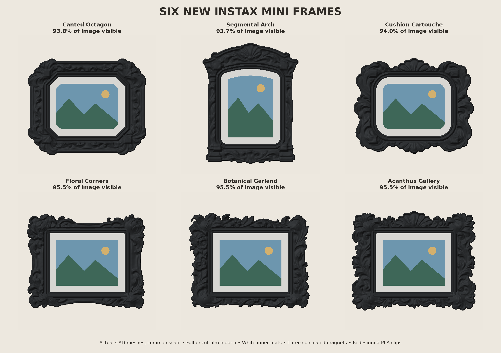

# Baroque Instax Frames

Six printable, Baroque-inspired fridge frames for **uncut Instax Mini photos**: a thin white inner mat, black floral relief, a matching snap-on back, and **three concealed 6 × 3 mm magnets**.



**[Download the complete collection](https://github.com/obartra/baroque-instax-frames/releases/tag/v0.1.0)** · [Models](models/) · [Renders](renders/) · [Build from source](docs/BUILDING.md) · [Share a print](CONTRIBUTING.md)

**Prototype release.** All seven projects passed geometry checks and two-plate Bambu Studio slicing. These new designs and revised clips have **not yet been physically printed or durability tested**. Start with the small clip coupon; real print photos and fit reports will be added as they become available. The images here are renders with schematic photo placeholders.

## Choose a frame

Each `.3mf` contains **both matching parts on two plates**, with the white and black assignments already set. Open it **as a project** in Bambu Studio.

| Design | Format | Print project | Actual mesh views | Design drawing |
| --- | --- | --- | --- | --- |
| Canted Octagon | Landscape, clipped corners | [3MF](models/01-Canted-Octagon-Instax-Mini-3-Magnets.3mf) | [Views](renders/01-Canted-Octagon-actual-multiview.png) | [Concept](concepts/01-Canted-Octagon-concept.png) |
| Segmental Arch | Portrait, shallow arched top | [3MF](models/02-Segmental-Arch-Instax-Mini-3-Magnets.3mf) | [Views](renders/02-Segmental-Arch-actual-multiview.png) | [Concept](concepts/02-Segmental-Arch-concept.png) |
| Cushion Cartouche | Landscape, consistent rounded corners | [3MF](models/03-Cushion-Cartouche-Instax-Mini-3-Magnets.3mf) | [Views](renders/03-Cushion-Cartouche-actual-multiview.png) | [Concept](concepts/03-Cushion-Cartouche-concept.png) |
| Floral Corners | Landscape, quiet rails and varied corner blooms | [3MF](models/04-Floral-Corners-Instax-Mini-3-Magnets.3mf) | [Views](renders/04-Floral-Corners-actual-multiview.png) | [Concept](concepts/04-Floral-Corners-concept.png) |
| Botanical Garland | Landscape, flowing flowers and leaves | [3MF](models/05-Botanical-Garland-Instax-Mini-3-Magnets.3mf) | [Views](renders/05-Botanical-Garland-actual-multiview.png) | [Concept](concepts/05-Botanical-Garland-concept.png) |
| Acanthus Gallery | Landscape, fuller leaf and scroll relief | [3MF](models/06-Acanthus-Gallery-Instax-Mini-3-Magnets.3mf) | [Views](renders/06-Acanthus-Gallery-actual-multiview.png) | [Concept](concepts/06-Acanthus-Gallery-concept.png) |

**[PLA clip fit test — print this first](models/PLA-Clip-Fit-Test.3mf)**: one fork and one socket, about 1 g total across two plates. [Clip detail renders](renders/PLA-Clip-Details.png).

## What fits

The carrier holds a complete **86 × 54 mm Instax Mini sheet**, with a nominal **62 × 46 mm image**. Do not trim the instant film. This is not sized for Polaroid Go, square Polaroid film, Instax Square or Instax Wide.

The white mat sits **inside** the ornamental frame. Its width is a constant **6.5 mm perpendicular offset** around the opening. The full paper border and back support are concealed in the computed straight-on view; angled views may reveal the assembly's depth. The shaped openings show about 94% of the nominal image area; the rectangular openings show about 95.5%.


The straight aperture edges overlap the nominal image by 0.6 mm. Geometry checks include image shifts of ±0.4 mm; actual film, printer and assembly tolerances still need physical verification. Dimensions and magnet locations for each design are in [validation/](validation/).

## Print and assemble

You need PLA in white and black, a multicolor-capable setup for the front, **three 6 mm diameter × 3 mm thick round magnets**, and an adhesive suitable for your PLA and magnets.

1. Print both plates of the **clip coupon** and check the fit with your filament. Align the socket squarely above the fork and press evenly.
2. Open a frame's 3MF as a project. The supplied profile targets a **Bambu P2S, 0.4 mm nozzle, textured PEI, PLA, 0.08 mm layers and a 0.20 mm first layer**. If using another machine, select its profile and inspect the resulting slice and clearances.
3. Map **filament 1 to white** and **filament 2 to black**. Plate 1 prints the white inner mat and black ornament as **one fused front**. Plate 2 prints its **matching white back**. No supports or prime tower are enabled.
4. Keep the first white layers: the mat is **0.36 mm high**, using the 0.20 mm first layer plus two 0.08 mm layers. The front then has one white-to-black transition; the back is single color. Review your machine's purge requirements when adapting the profile.
5. Glue the three magnets into the rear pockets, seating their exposed faces evenly at the rear plane. The pockets are 6.3 mm diameter × 3.1 mm deep with a 0.5 mm closed floor. Let the adhesive cure before inserting film. Keep loose magnets away from children and pets.
6. Align all four forks and press near each corner in turn to attach the matching back. These clips differ from the earlier collection: print **both new parts**, and keep each front with its own back.
7. Check insertion with a paper dummy first. For landscape frames, slide in from the **left**, narrow border first, leaving the wide caption border at the left. For the portrait arch, slide in from the **bottom**, narrow border first, caption border at the bottom. Slide gently to the firm stop; do not force the film.

The carrier has three guide sides and compliant edge fingers. The revised forks have longer flex arms, broader sections, flared bases, round-ended slots and a smaller retention lip. These changes are intended to reduce brittleness; no fatigue-life claim has been established.

## Files and verification

| Folder | Contents |
| --- | --- |
| `models/` | Six native two-plate 3MF projects plus the clip coupon |
| `renders/` | Actual-mesh front, rear, angle, profile, exploded and drawing-comparison views |
| `concepts/` | Six AI-generated master concept sheets |
| `source/` | CAD and render scripts, drawing prompts, parameters and printer settings |
| `validation/` | Geometry reports and exact-file slicer records |
| `photos/` | A place for future real prints and their permission records |

Check the download with Python 3.10 or newer, without installing CAD dependencies:

```sh
python3 tools/verify_release.py
```

This verifies the distributed file hashes, native 3MF structure, material assignments, two plates and recorded slicer results. It does **not** rerun the geometry solver or slicer. Those procedures are documented in [BUILDING.md](docs/BUILDING.md). The original release checks covered watertight meshes, assembly clearance, snap engagement, socket roofs, magnet floors, photo insertion and front-view concealment. Physical fit and long-term PLA behavior remain to be tested.

## Design process and reuse

These are contemporary Baroque-inspired designs built from **new AI concept drawings and custom CAD**. The ornamental surface is drawing-guided tonal bas-relief; the mouldings, apertures, carrier and snap geometry are explicitly constructed. Secondary concept angles are visual guidance, not a volumetric reconstruction. See [PROVENANCE.txt](PROVENANCE.txt), [the recorded prompts](source/designs-final.json) and [the design review](docs/DESIGN-REVIEW.txt).

This repository contains the new independent six-design collection. It contains no original MakerWorld frame meshes, earlier restricted remixes or personal photo references.

**Models, drawings, renders, parameters and documentation: [CC0 1.0](LICENSES/CC0-1.0.txt). Code: [MIT](LICENSES/MIT.txt).** You may make, modify, share and sell prints under those terms. Attribution is appreciated for the CC0 materials but is not required. The MIT notice must be retained with redistributed code. See [LICENSE](LICENSE) for scope and the AI provenance qualification.

Instax and Bambu names identify compatible film and printing tools. This project is not affiliated with their manufacturers.
