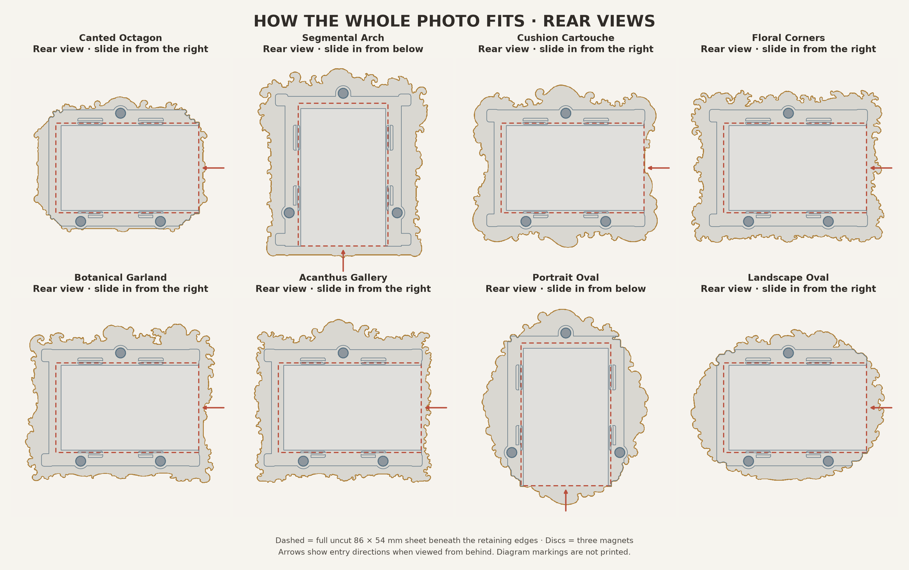

# Baroque Instax Frames

Six printable, Baroque-inspired fridge frames **with Rococo influences**, for **uncut Instax Mini photos**: a thin white inner mat, black floral relief, a matching snap-on back, and **three concealed 6 × 3 mm magnets**.

**Free to use, modify, share and sell prints.** Models and design assets use **CC0 1.0**; code uses **MIT**. No noncommercial restriction. [License scope](LICENSING.md).


**[Download the complete collection](https://github.com/obartra/baroque-instax-frames/releases/tag/v0.1.1)** · [Models](models/) · [Renders](renders/) · [Build from source](docs/BUILDING.md) · [Share a print](CONTRIBUTING.md)

**Prototype release.** All seven projects passed geometry checks and two-plate Bambu Studio slicing. These new designs and revised clips have **not yet been physically printed or durability tested**. Start with the small clip coupon; real print photos and fit reports will be added as they become available. The images here are renders with schematic photo placeholders.

## Choose a frame

Each `.3mf` contains **both matching parts on two plates**, with the white and black assignments already set. Open it **as a project** in Bambu Studio.

| Design | Format | Print project | Actual mesh views | Design drawing |
| --- | --- | --- | --- | --- |
| Canted Octagon | Landscape, clipped corners | [3MF](models/01-Canted-Octagon-Instax-Mini-3-Magnets.3mf) | [Views](renders/01-Canted-Octagon-actual-multiview.png) | [Concept](concepts/01-Canted-Octagon-concept.png) |
| Segmental Arch | Portrait, shallow arched top | [3MF](models/02-Segmental-Arch-Instax-Mini-3-Magnets.3mf) | [Views](renders/02-Segmental-Arch-actual-multiview.png) | [Concept](concepts/02-Segmental-Arch-concept.png) |
| Cushion Cartouche | Landscape, consistent rounded corners | [3MF](models/03-Cushion-Cartouche-Instax-Mini-3-Magnets.3mf) | [Views](renders/03-Cushion-Cartouche-actual-multiview.png) | [Concept](concepts/03-Cushion-Cartouche-concept.png) |
| Floral Corners | Landscape, quiet rails and varied corner blooms | [3MF](models/04-Floral-Corners-Instax-Mini-3-Magnets.3mf) | [Views](renders/04-Floral-Corners-actual-multiview.png) | [Concept](concepts/04-Floral-Corners-concept.png) |
| Botanical Garland | Landscape, flowing flowers and leaves | [3MF](models/05-Botanical-Garland-Instax-Mini-3-Magnets.3mf) | [Views](renders/05-Botanical-Garland-actual-multiview.png) | [Concept](concepts/05-Botanical-Garland-concept.png) |
| Acanthus Gallery | Landscape, fuller leaf and scroll relief | [3MF](models/06-Acanthus-Gallery-Instax-Mini-3-Magnets.3mf) | [Views](renders/06-Acanthus-Gallery-actual-multiview.png) | [Concept](concepts/06-Acanthus-Gallery-concept.png) |

**[PLA clip fit test — print this first](models/PLA-Clip-Fit-Test.3mf)**: one fork and one socket, about 1 g total across two plates. [Clip detail renders](renders/PLA-Clip-Details.png).

## What fits

The carrier holds a complete **86 × 54 mm Instax Mini sheet**, with a nominal **62 × 46 mm image**. Do not trim the instant film. This is not sized for Polaroid Go, square Polaroid film, Instax Square or Instax Wide.

The white mat sits **inside** the ornamental frame. Its width is a constant **6.5 mm perpendicular offset** around the opening. The full paper border and back support are concealed in the computed straight-on view; angled views may reveal the assembly's depth. The shaped openings show about 94% of the nominal image area; the rectangular openings show about 95.5%.



The straight aperture edges overlap the nominal image by 0.6 mm. Geometry checks include image shifts of ±0.4 mm; actual film, printer and assembly tolerances still need physical verification. Dimensions and magnet locations for each design are in [validation/](validation/).

## Print and assemble

Follow the six steps below. You need white and black PLA, a multicolor-capable setup for the front, **three Ø6 × 3 mm magnets**, and suitable glue. [Detailed print settings, assembly notes and safety](docs/PRINTING.md).


Use a paper dummy before inserting film. **Keep the instant film whole.** [Editable SVG diagrams and geometry sources](docs/assembly/README.md).

## Files and verification

| Folder | Contents |
| --- | --- |
| `models/` | Six native two-plate 3MF projects plus the clip coupon |
| `renders/` | Actual-mesh front, rear, angle, profile, exploded and drawing-comparison views |
| `concepts/` | Six AI-generated master concept sheets |
| `source/` | CAD and render scripts, drawing prompts, parameters and printer settings |
| `validation/` | Geometry reports and exact-file slicer records |
| `photos/` | A place for future real prints and their permission records |

Check the download with Python 3.10 or newer, without installing CAD dependencies:

```sh
python3 tools/verify_release.py
```

This verifies the distributed file hashes, native 3MF structure, material assignments, two plates and recorded slicer results. It does **not** rerun the geometry solver or slicer. Those procedures are documented in [BUILDING.md](docs/BUILDING.md). The original release checks covered watertight meshes, assembly clearance, snap engagement, socket roofs, magnet floors, photo insertion and front-view concealment. Physical fit and long-term PLA behavior remain to be tested.

## Design process and reuse

These are contemporary designs built from **new AI concept drawings and custom CAD**. Their architecture and ornament draw on Baroque and Rococo vocabulary; they are not period reproductions. The ornamental surface is drawing-guided tonal bas-relief; the mouldings, apertures, carrier and snap geometry are explicitly constructed. Secondary concept angles are visual guidance, not a volumetric reconstruction. See [PROVENANCE.txt](PROVENANCE.txt), [the recorded prompts](source/designs-final.json) and [the historical review of all six models](docs/HISTORICAL-REVIEW.md).

This repository contains the new independent six-design collection. It contains no original MakerWorld frame meshes, earlier restricted remixes or personal photo references.

**Models, drawings, renders, parameters and documentation: [CC0 1.0](LICENSE). Code: [MIT](LICENSES/MIT.txt).** You may make, modify, share and sell prints under those terms. Attribution is appreciated for the CC0 materials but is not required. The MIT notice must be retained with redistributed code. See [LICENSING.md](LICENSING.md) for scope and the AI provenance qualification.

Instax and Bambu names identify compatible film and printing tools. This project is not affiliated with their manufacturers.
