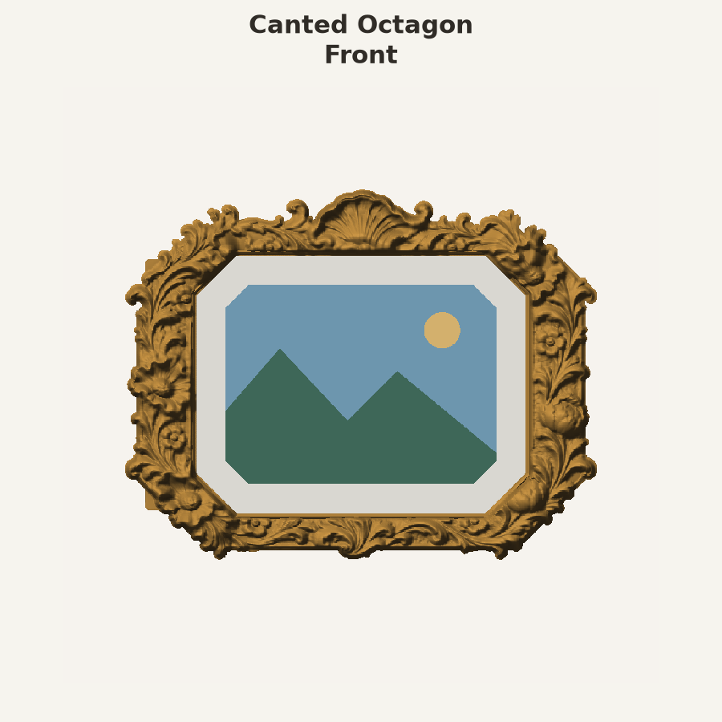
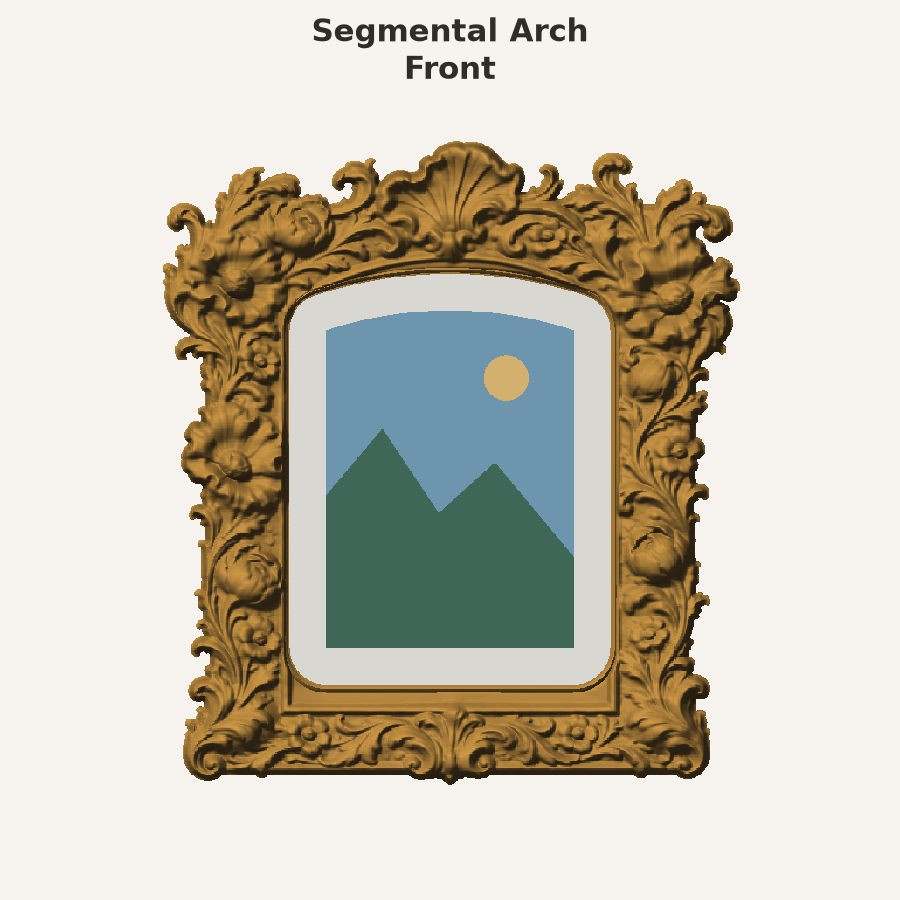
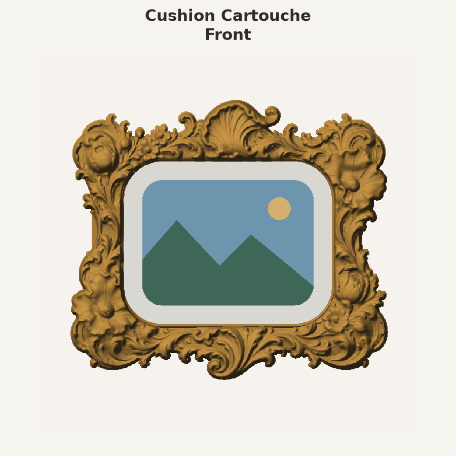
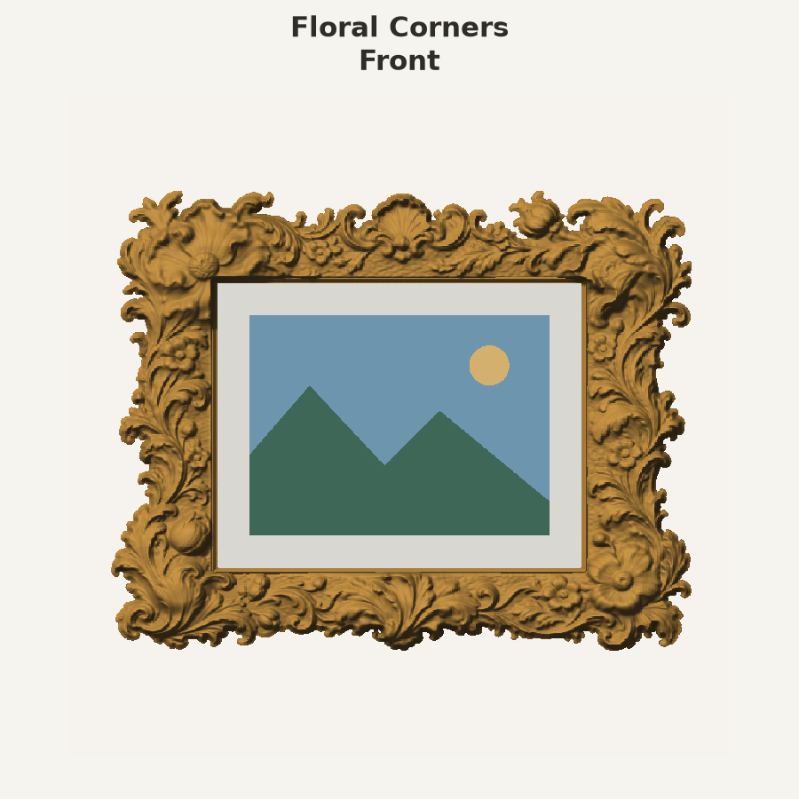
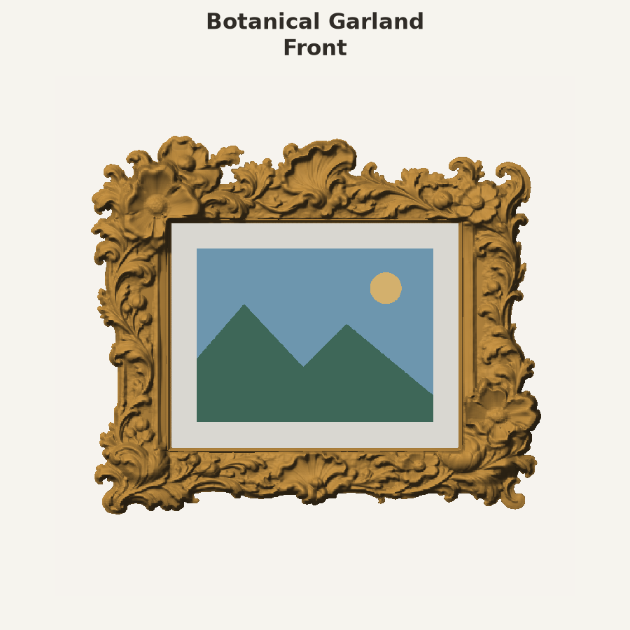
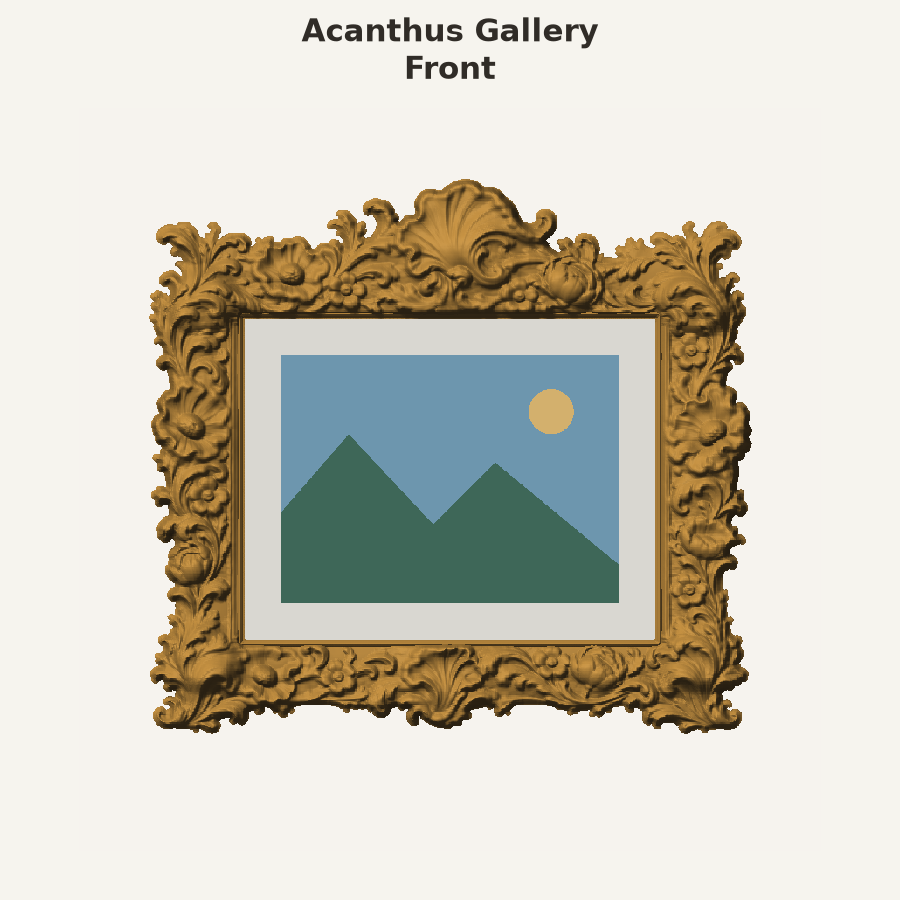
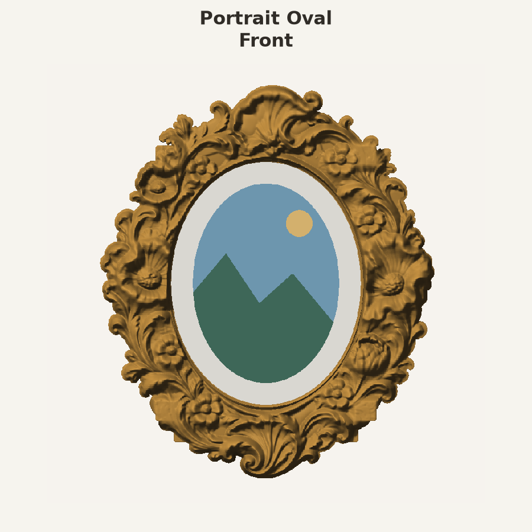
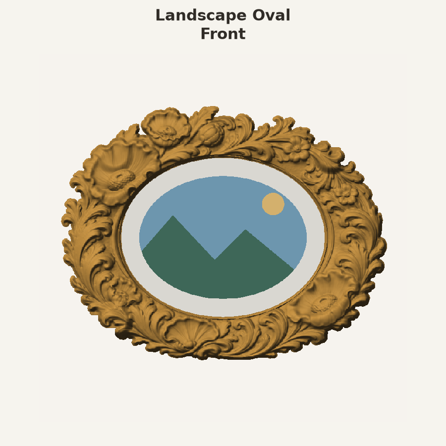
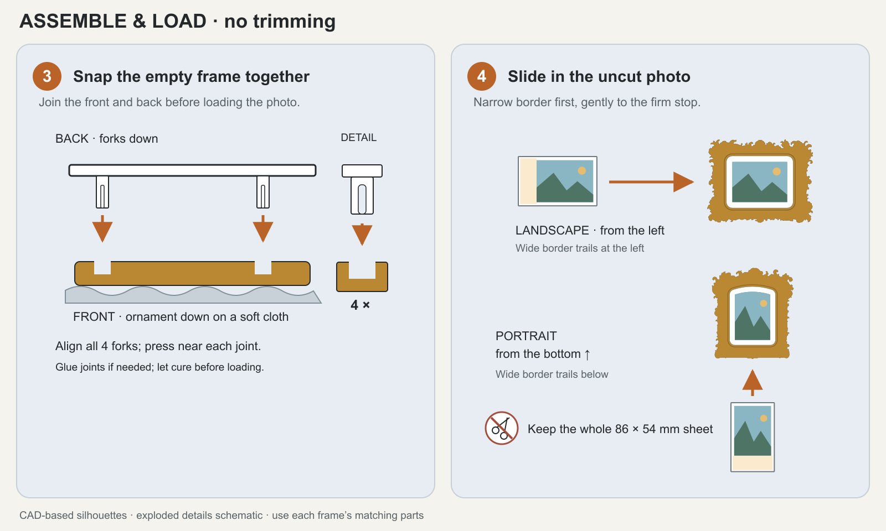
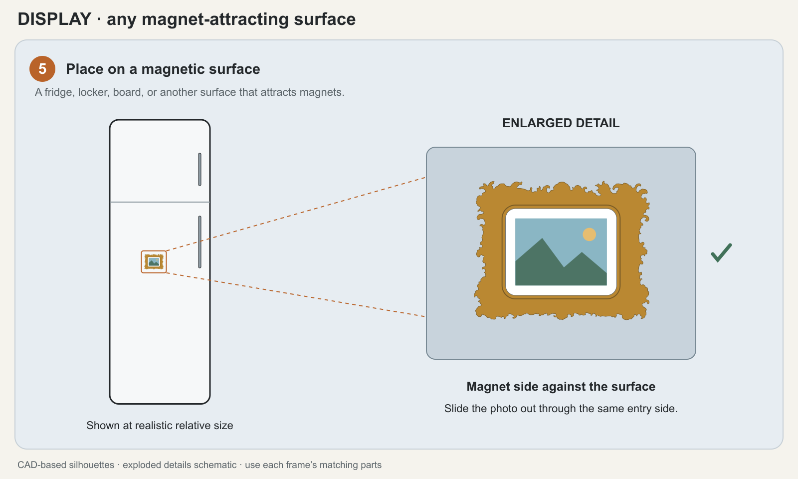

# Floral Instax Frames

Eight floral frames for **whole, uncut Instax Mini photos**. Print a front and
matching back, slide in your photo, and display it on a magnetic surface.
Each frame holds **three Ø6 × 3 mm magnets**. Choose your own print colors.

## Choose a frame

Each **3MF includes both matching parts on two plates**. Open it as a project
in Bambu Studio to retain the assembly and material assignments. The previews
use example materials; the model dimensions and geometry are the actual files.
Click an image to inspect it, or use the view links to see its relief and back.

| Preview | Design & files | More views |
| --- | --- | --- |
|  | **Canted Octagon** Landscape · 104.7 × 81.9 mm **[Download 3MF](models/current/12-Rocaille-Canted-Octagon-Instax-Mini-3-Magnets.3mf)** | [Front](renders/current/canted-octagon-front.png) · [Angled](renders/current/canted-octagon-angle.png) [Back](renders/current/canted-octagon-back.png) · [Photo fit](renders/current/canted-octagon-fit.png) |
|  | **Segmental Arch** Portrait · 102.6 × 114.5 mm **[Download 3MF](models/current/13-Rocaille-Segmental-Arch-Instax-Mini-3-Magnets.3mf)** | [Front](renders/current/segmental-arch-front.png) · [Angled](renders/current/segmental-arch-angle.png) [Back](renders/current/segmental-arch-back.png) · [Photo fit](renders/current/segmental-arch-fit.png) |
|  | **Cushion Cartouche** Landscape · 111.4 × 98.3 mm **[Download 3MF](models/current/14-Rocaille-Cushion-Cartouche-Instax-Mini-3-Magnets.3mf)** | [Front](renders/current/cushion-cartouche-front.png) · [Angled](renders/current/cushion-cartouche-angle.png) [Back](renders/current/cushion-cartouche-back.png) · [Photo fit](renders/current/cushion-cartouche-fit.png) |
|  | **Floral Corners** Landscape · 116.3 × 92.2 mm **[Download 3MF](models/current/15-Rocaille-Floral-Corners-Instax-Mini-3-Magnets.3mf)** | [Front](renders/current/floral-corners-front.png) · [Angled](renders/current/floral-corners-angle.png) [Back](renders/current/floral-corners-back.png) · [Photo fit](renders/current/floral-corners-fit.png) |
|  | **Botanical Garland** Landscape · 114.3 × 96.0 mm **[Download 3MF](models/current/16-Rocaille-Botanical-Garland-Sculpted-v3-Instax-Mini-3-Magnets.3mf)** | [Front](renders/current/botanical-garland-front.png) · [Angled](renders/current/botanical-garland-angle.png) [Back](renders/current/botanical-garland-back.png) · [Photo fit](renders/current/botanical-garland-fit.png) |
|  | **Acanthus Gallery** Landscape · 107.2 × 98.7 mm **[Download 3MF](models/current/17-Rocaille-Acanthus-Gallery-Instax-Mini-3-Magnets.3mf)** | [Front](renders/current/acanthus-gallery-front.png) · [Angled](renders/current/acanthus-gallery-angle.png) [Back](renders/current/acanthus-gallery-back.png) · [Photo fit](renders/current/acanthus-gallery-fit.png) |
|  | **Portrait Oval** Portrait · 100.6 × 118.4 mm **[Download 3MF](models/current/11-Period-Floral-Portrait-Oval-Instax-Mini-3-Magnets.3mf)** | [Front](renders/current/portrait-oval-front.png) · [Angled](renders/current/portrait-oval-angle.png) [Back](renders/current/portrait-oval-back.png) · [Photo fit](renders/current/portrait-oval-fit.png) |
|  | **Landscape Oval** Landscape · 117.0 × 91.4 mm **[Download 3MF](models/current/18-Rocaille-Landscape-Oval-Instax-Mini-3-Magnets.3mf)** | [Front](renders/current/landscape-oval-front.png) · [Angled](renders/current/landscape-oval-angle.png) [Back](renders/current/landscape-oval-back.png) · [Photo fit](renders/current/landscape-oval-fit.png) |

The Botanical Garland includes the latest sculpted petal and flower-center
revision. Its preceding matching three-magnet back remains compatible.
Always keep each of the other designs with its own matching back.

## Print and assemble

You need PLA, two contrasting materials for the front, a multicolor-capable
setup, **three Ø6 × 3 mm magnets**, and suitable glue. The back prints separately,
so its material is your choice. The inner mat is only **0.36 mm thick**.

Landscape photos enter from the **left**; portrait photos enter from the
**bottom**. The wide caption border trails behind. Keep the instant film whole.
The joints only need to engage once and may be glued after seating; let adhesive
cure before loading the photo. [Print settings and assembly details](docs/PRINTING.md)
· [Editable diagrams](docs/assembly/README.md).

## How the whole photo fits

The whole **86 × 54 mm sheet** and back are concealed **when viewed from the
front**; the carrier can be visible at shallow angles. The opening deliberately
masks a little of the image; the ovals mask
more. In the diagram below, the dashed outline traces the hidden sheet and
the circles mark the three magnets behind the frame.

These fit **Instax Mini**, rather than Polaroid Go, full-size Polaroid, Instax
Square or Instax Wide. [Dimensions, crop percentages and checks](catalog/current.json).

## Before you print

The supplied projects were checked and sliced for **Bambu P2S, 0.4 mm nozzle,
PLA and textured PEI**, using a 0.20 mm first layer and 0.08 mm following layers.
Reslice for your printer and assign your actual materials. No print is started
by opening these files.

These are **prototypes**. Digital checks cover closed meshes, four clip/socket
engagements, photo clearance, front-view concealment and three magnet pockets. All back
layers have extrusion-path checks. Physical fit, adhesive hold and fine surface
detail still need testing. [Current build and review notes](docs/CURRENT-CATALOG.md)
· [Geometry and slicer records](validation/current/).

## Design, source and license

Modern miniatures informed by French Louis XV floral Rococo, approximately
1735–1750. They use supported printable relief rather than full carved undercuts
and are new compositions, rather than replicas of documented antique frames.
[Historical sources and design limits](docs/CURRENT-CATALOG.md#historical-basis).

**Models, renders and documentation: CC0-1.0**, to the extent rights exist.
**Code: MIT.** Use, modify, share and sell your prints.
[License scope](LICENSING.md) · [Current CAD inputs](source/designs-current.json)
· [Rebuild instructions](docs/CURRENT-CATALOG.md#rebuild).

The earlier six-frame release remains available in the repository history and
original model paths. The table above links to the current eight prototypes.
Renders use a drawn photo placeholder; contributed print photos can be added
with their [permission record](photos/README.md).
