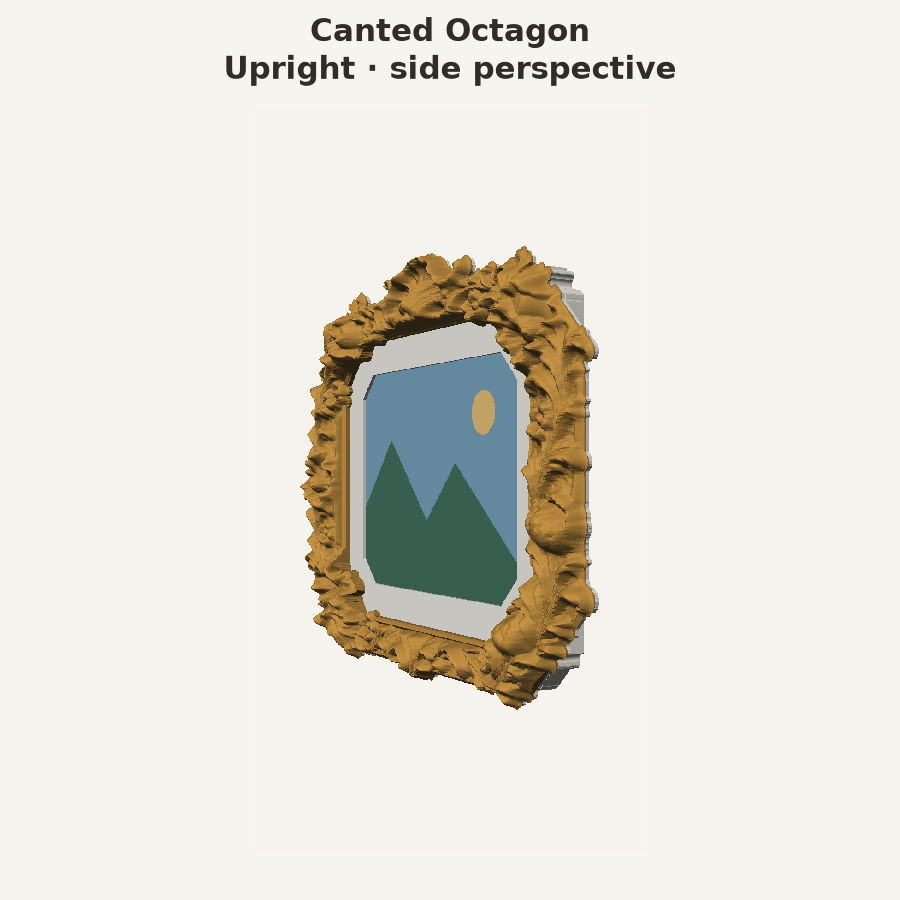
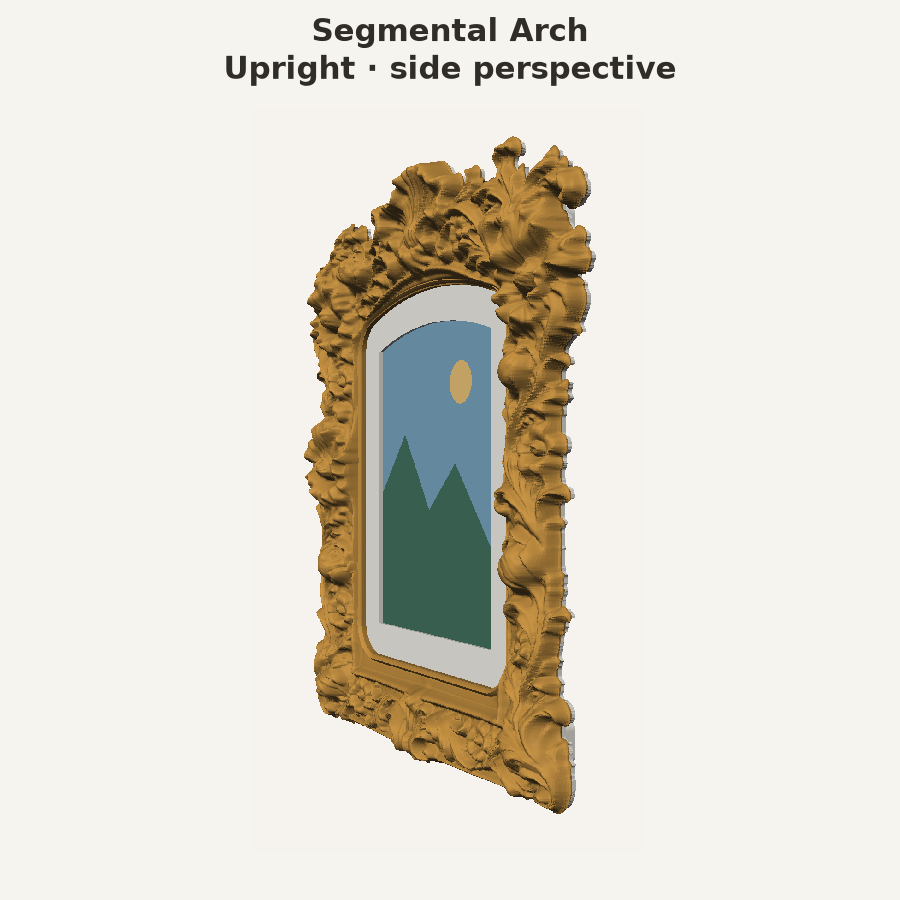
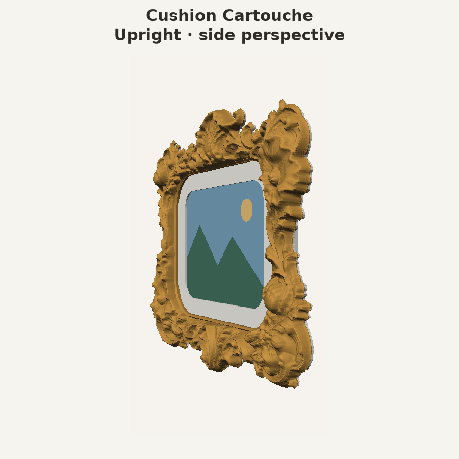
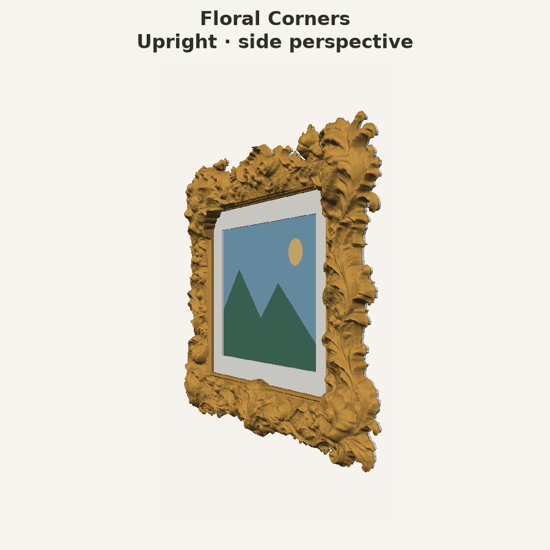
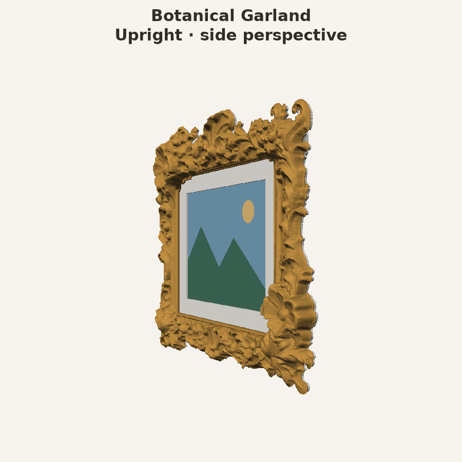
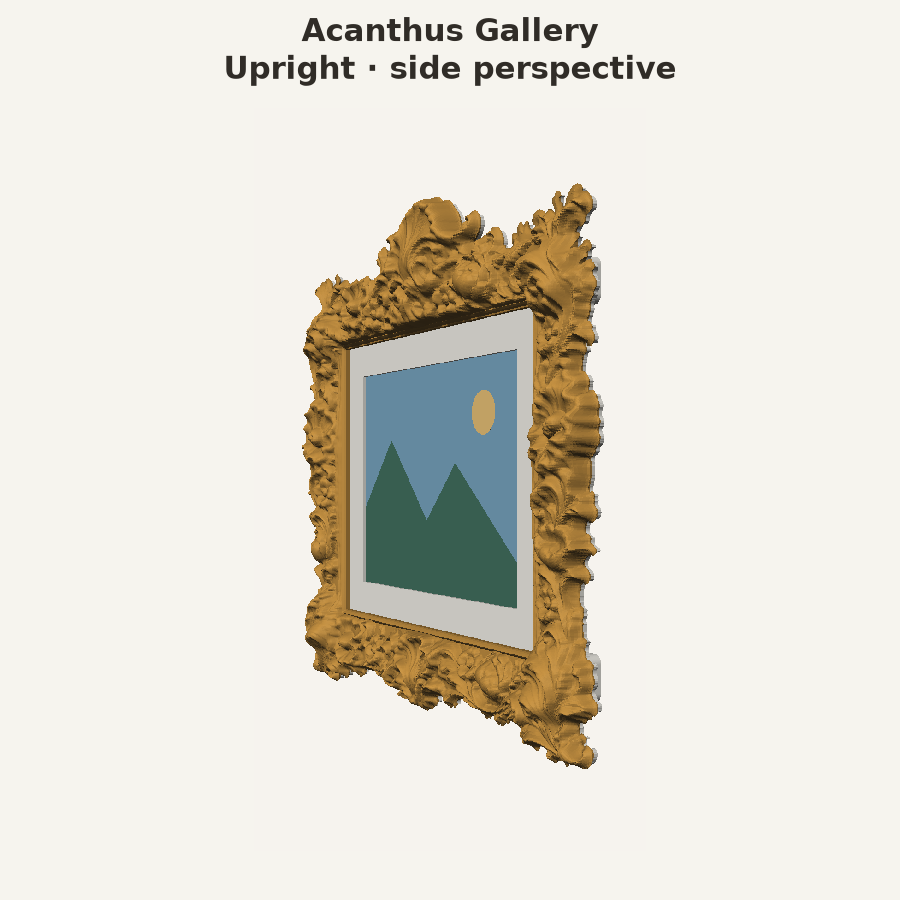
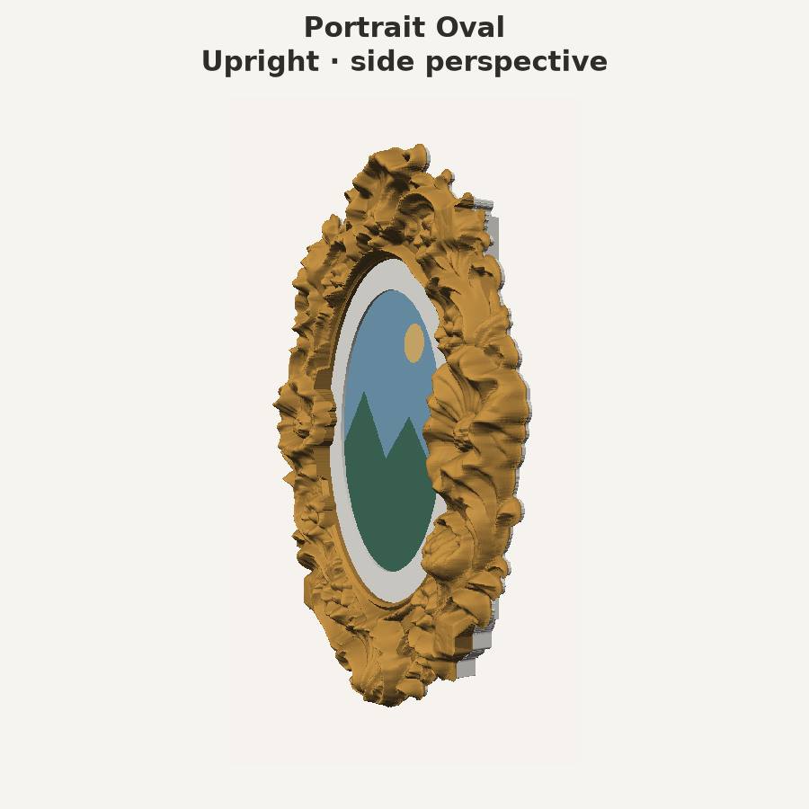
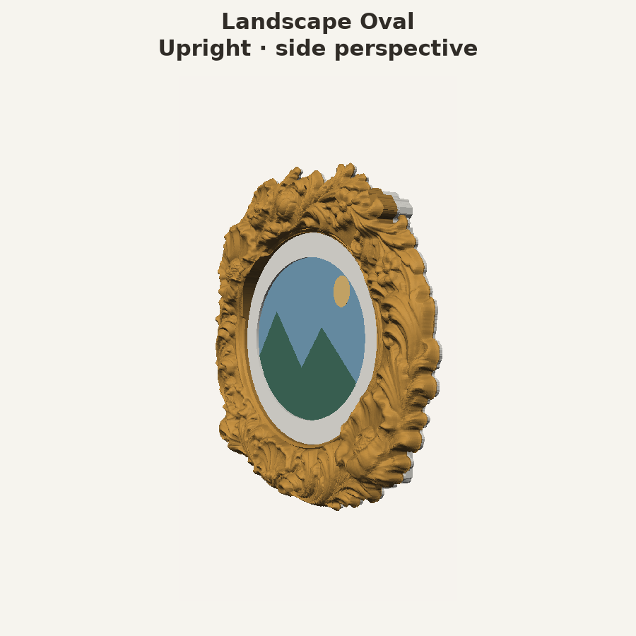
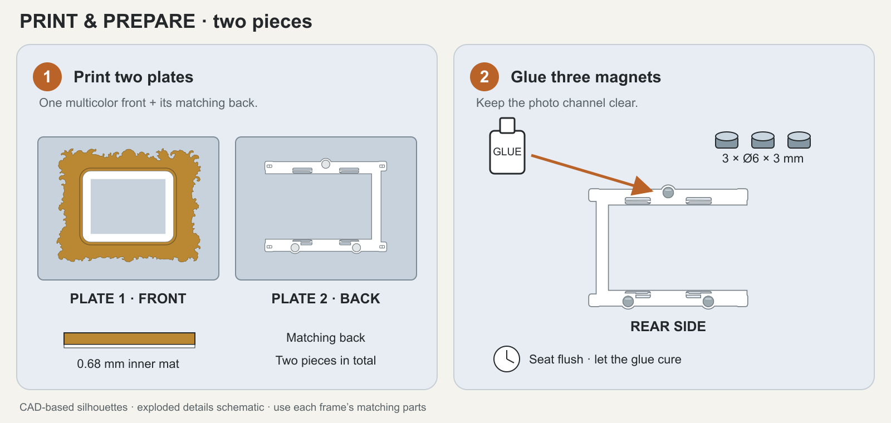
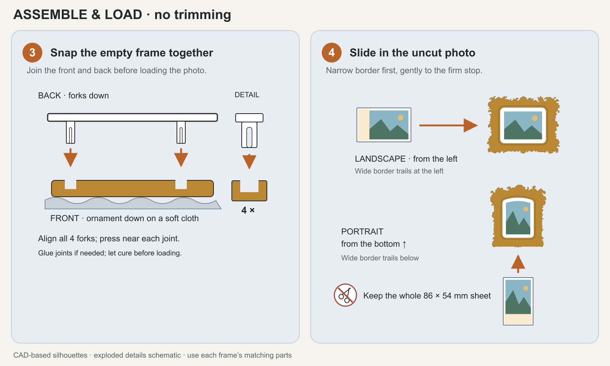

# Floral Instax Frames

  
   Segmental Arch · actual frame mesh, simulated photo

Eight floral frames for **whole, [uncut Instax Mini photos](https://www.instaxus.com/film/mini-white-film/)**. Print a front and
matching back, slide in your photo, and display it on a magnetic surface.
Each frame holds **[three Ø6 × 3 mm magnets](https://www.amazon.com/s?k=6x3mm+neodymium+disc+magnets)**.

**[Explore the collection on the website →](https://obartra.github.io/baroque-instax-frames/)**

[Frames](#choose-a-frame) · [Assembly](#print-and-assemble) · [Photo fit](#how-the-whole-photo-fits) · [Print setup](#before-you-print) · [Source & license](#design-source-and-license)

## 🖼️ Choose a frame

Each **3MF includes both matching parts on two plates**. Open it as a project
in Bambu Studio to retain the assembly and material assignments. The previews
use example materials; the model dimensions and geometry are the actual files.
The previews show each frame upright, viewed from the side in perspective to show the
carving and depth. Click to enlarge, or use the view links for straight-on, rear
and photo-fit views.

For other slicers, download the **STL ZIP**: ornament, mat and matching back.
Keep the mat and ornament aligned as one front, and choose your own print
settings. [STL import details](docs/PRINTING.md#using-the-stl-downloads).

| Preview | Design & files | More views |
| --- | --- | --- |
|  | **Canted Octagon** Landscape · 104.7 × 81.9 mm **[Download 3MF](models/current/12-Rocaille-Canted-Octagon-Instax-Mini-3-Magnets.3mf)** · [STL ZIP](models/current/stl/canted-octagon-stl.zip) | [Front](renders/current/canted-octagon-front.png) · [Angled](renders/current/canted-octagon-side-perspective-v2.png) [Back](renders/current/canted-octagon-back.png) · [Photo fit](renders/current/canted-octagon-rear-fit.png) |
|  | **Segmental Arch** Portrait · 102.6 × 114.5 mm **[Download 3MF](models/current/13-Rocaille-Segmental-Arch-Instax-Mini-3-Magnets.3mf)** · [STL ZIP](models/current/stl/segmental-arch-stl.zip) | [Front](renders/current/segmental-arch-front.png) · [Angled](renders/current/segmental-arch-side-perspective-v2.png) [Back](renders/current/segmental-arch-back.png) · [Photo fit](renders/current/segmental-arch-rear-fit.png) |
|  | **Cushion Cartouche** Landscape · 111.4 × 98.3 mm **[Download 3MF](models/current/14-Rocaille-Cushion-Cartouche-Instax-Mini-3-Magnets.3mf)** · [STL ZIP](models/current/stl/cushion-cartouche-stl.zip) | [Front](renders/current/cushion-cartouche-front.png) · [Angled](renders/current/cushion-cartouche-side-perspective-v2.png) [Back](renders/current/cushion-cartouche-back.png) · [Photo fit](renders/current/cushion-cartouche-rear-fit.png) |
|  | **Floral Corners** Landscape · 116.3 × 92.2 mm **[Download 3MF](models/current/15-Rocaille-Floral-Corners-Instax-Mini-3-Magnets.3mf)** · [STL ZIP](models/current/stl/floral-corners-stl.zip) | [Front](renders/current/floral-corners-front.png) · [Angled](renders/current/floral-corners-side-perspective-v2.png) [Back](renders/current/floral-corners-back.png) · [Photo fit](renders/current/floral-corners-rear-fit.png) |
|  | **Botanical Garland** Landscape · 114.3 × 96.0 mm **[Download 3MF](models/current/16-Rocaille-Botanical-Garland-Sculpted-v3-Instax-Mini-3-Magnets.3mf)** · [STL ZIP](models/current/stl/botanical-garland-stl.zip) | [Front](renders/current/botanical-garland-front.png) · [Angled](renders/current/botanical-garland-side-perspective-v2.png) [Back](renders/current/botanical-garland-back.png) · [Photo fit](renders/current/botanical-garland-rear-fit.png) |
|  | **Acanthus Gallery** Landscape · 107.2 × 98.7 mm **[Download 3MF](models/current/17-Rocaille-Acanthus-Gallery-Instax-Mini-3-Magnets.3mf)** · [STL ZIP](models/current/stl/acanthus-gallery-stl.zip) | [Front](renders/current/acanthus-gallery-front.png) · [Angled](renders/current/acanthus-gallery-side-perspective-v2.png) [Back](renders/current/acanthus-gallery-back.png) · [Photo fit](renders/current/acanthus-gallery-rear-fit.png) |
|  | **Portrait Oval** Portrait · 100.6 × 118.4 mm **[Download 3MF](models/current/11-Period-Floral-Portrait-Oval-Instax-Mini-3-Magnets.3mf)** · [STL ZIP](models/current/stl/portrait-oval-stl.zip) | [Front](renders/current/portrait-oval-front.png) · [Angled](renders/current/portrait-oval-side-perspective-v2.png) [Back](renders/current/portrait-oval-back.png) · [Photo fit](renders/current/portrait-oval-rear-fit.png) |
|  | **Landscape Oval** Landscape · 117.0 × 91.4 mm **[Download 3MF](models/current/18-Rocaille-Landscape-Oval-Instax-Mini-3-Magnets.3mf)** · [STL ZIP](models/current/stl/landscape-oval-stl.zip) | [Front](renders/current/landscape-oval-front.png) · [Angled](renders/current/landscape-oval-side-perspective-v2.png) [Back](renders/current/landscape-oval-back.png) · [Photo fit](renders/current/landscape-oval-rear-fit.png) |

The Botanical Garland includes the latest sculpted petal and flower-center
revision. Its preceding matching three-magnet back remains compatible.
Always keep each of the other designs with its own matching back.

## 🧩 Print and assemble

You need filament, **[three Ø6 × 3 mm magnets](https://www.amazon.com/s?k=6x3mm+neodymium+disc+magnets)**, and suitable glue.
Use one filament for the whole frame, or choose separate mat and frame colors.
The back prints separately. The reinforced inner mat is **0.68 mm thick**—seven layers at the supplied settings.

Landscape photos enter from the **left**; portrait photos enter from the
**bottom**. The wide caption border trails behind. Keep the instant film whole.
The joints only need to engage once and may be glued after seating; let adhesive
cure before loading the photo. [Print settings and assembly details](docs/PRINTING.md)
· [Editable diagrams](docs/assembly/README.md).

## 📷 How the whole photo fits

The whole **86 × 54 mm sheet** and back are concealed **when viewed from the
front**; the carrier can be visible at shallow angles. The opening deliberately
masks a little of the image; the ovals mask more.

These **rear views** show the retaining supports, three magnets and full sheet.
The dashed outline follows the uncut film beneath the retaining edges; arrows
show how it slides in. Viewed from behind, landscape entry appears on the
**right** (the left when seen from the front); portrait entry stays below.

These fit **Instax Mini**, rather than Polaroid Go, full-size Polaroid, Instax
Square or Instax Wide. [Dimensions, crop percentages and checks](catalog/current.json).

## 🖨️ Before you print

| Check | Included setting / what you need |
| --- | --- |
| **Printer & nozzle** | Bambu P2S · 0.4 mm nozzle |
| **Filament** | Up to two colors: one for the mat, one for the frame and back |
| **Layer height** | 0.20 mm first layer, then 0.08 mm |
| **Reinforced mat** | 0.68 mm · seven mat layers |
| **Magnets** | Three discs per frame: **[6 mm diameter × 3 mm thick](https://www.amazon.com/s?k=6x3mm+neodymium+disc+magnets)** |

**Open as a project** to keep the matching parts, plates and material assignments.
Set the printer, nozzle and filament profiles before slicing. For a single-color
front, assign the mat and ornament to the same filament; different colors need
a setup that can change filament during the print.

**Let the plate cool**, then flex it away from the frame. Avoid pulling on the
inner mat or projecting flowers.

## 🌿 Design, source and license

**French floral Rococo, made miniature.** New compositions informed by Louis XV
frames, approximately **1735–1750**, adapted to supported printable relief and
whole Instax Mini sheets. [Historical references & design notes](docs/CURRENT-CATALOG.md#historical-basis).

**Make them yours:** use, modify, share, and sell your prints.

| What | License |
| --- | --- |
| **Models, renders & documentation** | [CC0-1.0](LICENSES/CC0-1.0.txt) |
| **Code** | [MIT](LICENSES/MIT.txt) |

CC0 applies to the rights we can waive. [License scope & third-party materials](LICENSING.md).

🛠️ Explore the source and earlier releases

- [Current CAD inputs](source/designs-current.json)
- [Build and review notes](docs/CURRENT-CATALOG.md)
- [Geometry and slicer records](validation/current/)
- [Rebuild the frames](docs/CURRENT-CATALOG.md#rebuild)
- [Creation and provenance record](PROVENANCE.txt)
- [Project icon & simulated photo](assets/brand/README.md)

The earlier six-frame release remains in the repository history and original
model paths. The table above links to the current eight prototypes.

Catalog views use a drawn photo placeholder; the project icon uses an AI-simulated
photo. Share your own print photos with a [permission record](photos/README.md).
