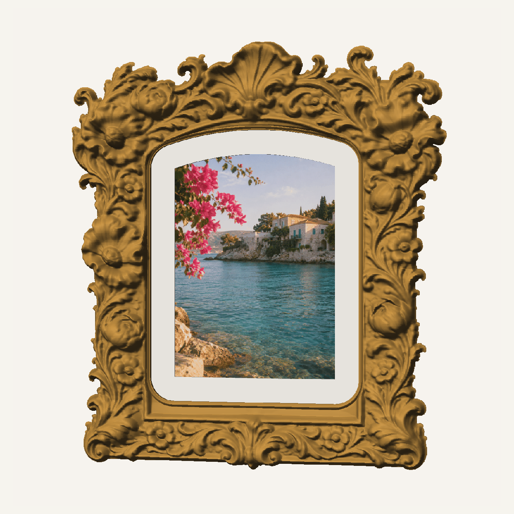

# Project icon



The icon uses the **actual current Segmental Arch printable mesh**, with a
simulated coastal photograph placed inside the real aperture. Its gold ornament
and warm-white mat are illustrative color choices. The model geometry is unchanged.

The photograph was created with the built-in image-generation tool on
November 17, 2026. It depicts an imagined coastal scene, rather than a documented
place or a contributor’s personal photo. The frame was rendered from CAD; it was
not generated as part of that photograph.

- [Original simulated photo](simulated-coastal-photo.png)
- [Exact prompt, asset hash and model provenance](generation-record.json)
- [CAD rendering script](../../source/render_project_icon.py)

With the [CAD dependencies](../../source/requirements.txt) installed, rebuild from
the repository root:

```sh
python source/render_project_icon.py
```

The saved photo is a cached input, so rebuilding the icon requires no image
inference. It is resized and quantized for the renderer’s photo material.
The script checks that the native frame project remains unchanged.

These image assets and this documentation follow the project’s
[CC0 dedication](../../LICENSES/CC0-1.0.txt), to the extent rights exist and can
be waived. The rendering code is [MIT](../../LICENSES/MIT.txt).
