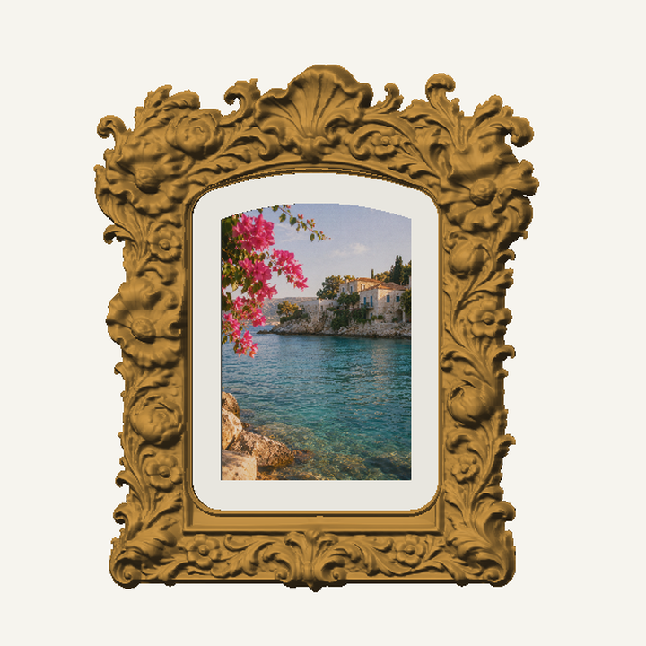

# Photo insertion demo

[](https://obartra.github.io/baroque-instax-frames/#top)

[Watch on the project website](https://obartra.github.io/baroque-instax-frames/#top)
· [MP4](photo-insertion.mp4) · [WebM](photo-insertion.webm)

This is a render of the actual current Segmental Arch and its matching back.
The complete 54 × 86 mm film sheet translates upward through the bottom entry;
its front plane is depth-tested against the assembled model. The narrow border
leads and the wide border trails. The photograph is the cached
[AI-simulated coastal image](../brand/README.md).

The camera closes in after insertion and makes a small settling pulse. That
pulse is presentation motion: the photo does not overshoot the stop, the model
does not deform, and the animation does not introduce a photo latch.

The website plays once when visible, holds the final view, and offers pause/replay. It shows
a still poster by default when reduced motion is requested. Native video controls
remain available without JavaScript. Videos have no audio.

Rebuild in the project's CAD Python environment, with FFmpeg installed:

```sh
python source/render_insertion_animation.py
```

Run this from the repository root. `FFMPEG` can specify another executable path.
The frame's mesh/depth render is cached under ignored `build/`; the moving film
material is composited using that depth buffer. The original model hash is checked
before and after rendering. [Camera, motion and output hashes](render-record.json).

Render assets and documentation: [CC0](../../LICENSES/CC0-1.0.txt), within the
project's [license scope](../../LICENSING.md). Rendering code: [MIT](../../LICENSES/MIT.txt).
