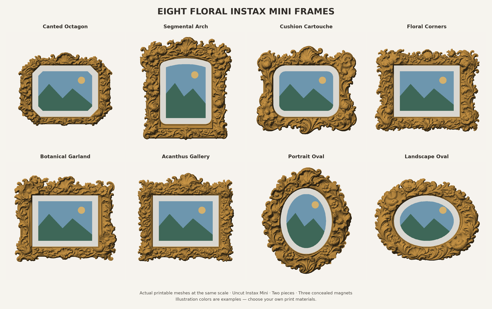

Eight floral magnetic frames for full, uncut Instax Mini photos, with matching backs and three concealed 6 × 3 mm magnets per frame.

Choose a download:

- **3MF:** eight Bambu Studio projects, each with its front and back on two plates.
- **STL:** eight folders of aligned mat, ornament and back parts, with import guides.
- **Complete:** both formats, plus front, angled, rear and photo-fit views for every design.
- **[Two-color P2S](https://github.com/obartra/baroque-instax-frames/releases/download/v0.2.0/Floral-Instax-Frames-v0.2.0-Two-Color-P2S.zip):** all eight editable Bambu Studio projects with plate previews. Mat uses slot 1; ornament and matching back share slot 2. Both parts are included on two plates per frame. Supplied settings are for a Bambu P2S with a 0.4 mm nozzle and PLA; choose your printer/material and re-slice when needed.

All packs include assembly illustrations, instructions, license details and a manifest. `SHA256SUMS` verifies the original three downloads; `Two-Color-P2S-SHA256SUMS` verifies the supplemental two-color pack. Native 3MF and STL data match the current checked catalog. The two-color projects preserve its geometry and reinforced mats while assigning the back to the ornament filament slot. All eight supplemental projects passed local slicing with two plates, one front color change, no back color changes and no warnings. This is digital validation, not a claim of physical testing of every design.

The collection includes Canted Octagon, Segmental Arch, Cushion Cartouche, Floral Corners, Botanical Garland, Acanthus Gallery, Portrait Oval and Landscape Oval. These are the current versions with reinforced 0.68 mm inner mats and matching three-magnet backs.

[Browse the frames and illustrated instructions](https://obartra.github.io/baroque-instax-frames/) · [MakerWorld](https://makerworld.com/en/models/3636176-rococo-instax-mini-magnetic-frames-8-designs) · [Printables](https://www.printables.com/model/1920140-rococo-instax-mini-magnetic-frames-8-designs)

Models, project artwork and documentation are CC0 within the documented scope; code is MIT. The repository's source archives remain available below.
